# 飞牛影视 + 网盘直连 家用影音库

> **仓库名说明**：`fntv-douban-kit` = 飞牛影视（**fn-TV**）+ 豆瓣插件（**douban**）+ 工具包（**kit**）。
> 里面装了两样东西：① 在 NAS 上部署飞牛影视 + OpenList 的全流程（第 0–5、7–8 章）；② 一个篡改猴插件，补豆瓣匹配和集号修复（第 6 章，就一个 js 文件）。

**一句话**：让 NAS 上的飞牛影视直接播放你网盘里的片子——不下载、不占硬盘，NAS 上只存几百字节一个的「指路牌」。

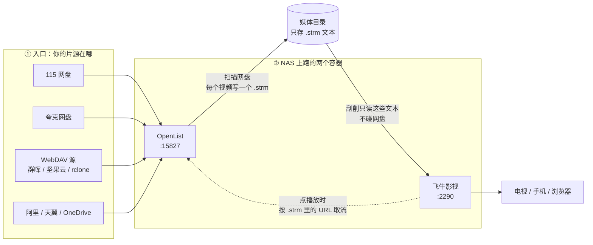

**刮削全程不碰网盘**——这是它跟「把网盘挂成 WebDAV 直接喂给媒体服务器」最大的区别，也是不会被网盘风控封号的原因，详见[下面](#刮削根本不碰网盘所以不存在封号风险)。

---

## 30 秒判断：这套适合你吗

### 适合你，如果——

- ✅ 你有一台 NAS（群晖、飞牛 fnOS、威联通、任意装了 Docker 的 Linux 机器）
- ✅ 你的片子主要存在**网盘**里，NAS 硬盘装不下或者不想装满
- ✅ 你希望在电视、手机上用**一个 App** 统一看这些片子，有海报墙、有选集
- ✅ 你愿意花 20 分钟敲几条命令（会复制粘贴就行，不用懂编程）

### 别往下看了，如果——

- ❌ **你没有 NAS**，只有一台 Windows 电脑 → 直接用 PotPlayer / Infuse 挂载网盘更省事，这套对你没意义
- ❌ **片子都在 NAS 本地硬盘上** → 不需要 strm，飞牛影视直接建库就行，跳过第 3、4 章
- ❌ **你想让 NAS 自动把网盘片子下载到本地** → 那是 qBittorrent + 离线下载的活，这套方案反而**不下载**
- ❌ **你完全不想碰命令行** → 这套要 SSH 建目录、跑 docker，绕不开
- ❌ **你想要自动追更、自动下载新集** → 这套只管「已有的片子怎么播」，不管「怎么获取新片」

## 四个词，看懂原理

| 词 | 是什么 | 一句话 |
|---|---|---|
| **飞牛影视** | NAS 上的影音库软件（[fnOS](https://www.fnnas.com) 自带，本教程用社区做的容器版 `trimmedia`） | 你的私人 Netflix，负责海报墙、选集、播放 |
| **网盘** | 115 / 夸克 / 阿里云盘…片子**实际存放**的地方 | 片源仓库 |
| **strm** | 一个**只有一行**的文本文件，内容是一条视频地址 | 书的**索书号卡片**，不是书本身 |
| **OpenList** | 把各种网盘统一成一个文件浏览器的工具 | 仓库管理员，负责点数、做卡片 |

> 为什么不能直接让飞牛读网盘？因为飞牛只认**本地文件**。strm 就是给它的一张「这张片子在哪儿」的纸条——飞牛看到纸条上的名字去刮海报，点播放时再顺着纸条上写的地址去网盘取流。纸条本身只有几百字节。

**NFO** 是 Kodi 那套「影片信息文件」，飞牛的「本地 NFO 模式」靠它。这套方案用不上，正常建库即可——文中提到 NFO 只是解释脚本在那种库里的降级行为。

## 装完之后你能做什么

| 你会得到 | 说明 |
|---|---|
| 飞牛影视网页版 | `http://NAS:2290`，海报墙、季集管理、硬解播放 |
| 网盘直连播放 | 115 / 夸克 的片子用 strm 映射，NAS 几乎不占空间 |
| 来源不限 115/夸克 | OpenList 能挂的都能进飞牛：阿里、天翼、OneDrive、PikPak，以及任何 **WebDAV** 服务 |
| 豆瓣匹配 | 官方手动匹配只有 TMDB，装个浏览器插件就能直接贴豆瓣链接 |
| 批量修复集号 | 文件名没集号、全挤在「特别篇」时，同一个插件一键重编 |

> 全流程不需要：改 NAS 文件系统的视频文件、装 Python、手写 NFO、登录任何第三方账号。

已验证环境：群晖 DSM 7.2（DS918+）+ Container Manager。fnOS、任意 Linux 同理。


---

## 目录

- [0. 准备](#0-准备)
- [1. 部署飞牛影视](#1-部署飞牛影视trimmedia)
- [2. 部署 OpenList](#2-部署-openlist)
- [3. OpenList 挂网盘](#3-openlist-挂网盘)
- [4. 生成 strm](#4-生成-strm)
- [5. 飞牛影视建媒体库](#5-飞牛影视建媒体库)
- [6. 装浏览器插件](#6-装浏览器插件豆瓣匹配--修复集号)
- [7. FAQ](#7-faq)
- [8. trimmedia-ext：标题排序修复](#8-trimmedia-ext标题排序修复官方-bug-的自救方案)
- [9. 备份与升级](#9-备份与升级)

> 想换自己的截图 / 看某张图对应哪一步？见 [SCREENSHOTS.md](SCREENSHOTS.md)。

---

## 整体结构

开头那张图里，每个角色具体干什么：

- **入口**（图左边那列）：115、夸克只是本教程拿来举例的两个。OpenList 的存储驱动有几十种，挂上哪个，飞牛就能刮哪个
- **OpenList**：把各种网盘统一成一套文件树，再批量生成 `.strm` 快捷方式
- **飞牛影视**（trimmedia 容器版）：只读 `.strm` 文件即可刮削+播放，真正的视频流从网盘走
- **浏览器插件**（篡改猴脚本）：给飞牛影视网页加两个按钮——豆瓣匹配、修复集号。装在 Chrome / Edge 里，不改服务端

> **WebDAV 也是一种入口**，不是出口。OpenList 里有个 `WebDAV` 驱动，只要对方提供一个 WebDAV 地址（账号密码），就能当网盘挂进来：
>
> - 群晖 / 威联通自带的 WebDAV 服务 → 片子在**另一台** NAS 的硬盘上时，不用拷贝、不用额外映射，直接接进来
> - 坚果云、InfiniCLOUD 这类支持 WebDAV 的网盘
> - 别人的 AList / OpenList、自己用 rclone 暴露出来的 WebDAV
>
> 挂上之后跟 115 完全一样：同样建一个 Strm 存储、同样生成 strm、同样进飞牛。具体见 [3.3](#33可选挂-webdav-源)。

### 刮削根本不碰网盘，所以不存在封号风险

这是本方案跟「把网盘挂成 WebDAV 直接喂给媒体服务器」最本质的区别。

飞牛建库时读的是 NAS 上那堆 `.strm` 文件——纯文本，打开就一行 URL。刮削（认片名、拉海报、写简介）走的是另一条完全独立的路：把**文件名**送去 TMDB 匹配。整个过程里，网盘那边收不到一个请求。

真正会碰网盘的只有两个时刻：

1. 你点播放，飞牛把 strm 里的 URL 交给播放器去拉流
2. 你手动让 OpenList 刷新索引（你自己点的，频率你说了算）

对比一下常见的「网盘挂成 WebDAV 直接让媒体服务器扫」：

| | 本方案（strm） | 网盘挂 WebDAV 给媒体服务器遍历 |
|---|---|---|
| 刮削 100 部剧 | **0 次网盘请求** | 逐级列目录、读文件信息，成千上万次 |
| 认片名 / 生成海报 | 只把文件名发给 TMDB | 通常还要读视频头探测时长、编码、抽帧 |
| 网盘那边看到的流量 | 只在播放时出现 | 建库期间持续、成片出现 |
| 新号被风控的可能 | 极低 | 高 |

所以「刮削会不会把号刮死」这个问题，在这套架构里根本不成立——**刮削压根没连上网盘**。你唯一要控制的是播放并发，[3.1](#31-挂-115-网盘) 里那个「限制速率 1」别省。

---

## 0. 准备

**硬件/系统**

- 一台能跑 Docker 的 NAS（群晖 DSM 7.x、fnOS、Unraid、普通 Linux 都行）
- 有 Intel/AMD 核显更好（4K 硬解），没有也能用，走软解，删掉 `devices` 那两行即可
- 磁盘空间：媒体目录只需要放 `.strm` 和海报，1 万集大概几百 MB

**软件**

- 群晖：套件中心安装 **Container Manager**（老版本叫 Docker）
- fnOS / Linux：已装 Docker + docker compose

**先规划好路径**（下面全部用这两个示例，改成你自己的）

| 用途 | 示例路径 |
|---|---|
| 媒体目录 | `/volume1/docker/trimmedia/media` |
| OpenList 数据 | `/volume1/docker/openlist` |

**用 SSH 登录 NAS**（群晖：控制面板 → 终端机 → 启用 SSH）

```bash
ssh 你的用户名@NAS的IP
id -u && id -g     # 记下这两个数字，部署时要用
```

> 群晖用户注意：`/volume1` 换成你自己的存储空间编号（可能是 `/volume2`、`/volume5`）。

---

## 1. 部署飞牛影视（trimmedia）

镜像：`ghcr.io/satxm/trimmedia:latest`（社区维护的飞牛影视独立化镜像，[原项目](https://github.com/satxm/trimmedia)）

### 1.1 建目录

```bash
BASE=/volume1/docker/trimmedia          # 改成你的路径
mkdir -p $BASE/media
mkdir -p $BASE/media/strm/{115,quark}   # strm 输出目录，按网盘分开放
```

### 1.2 启动容器

```bash
docker run -d \
  --name trimmedia \
  --restart unless-stopped \
  -e PUID=$(id -u) \
  -e GUID=$(id -g) \
  -e USER_NAME=admin \
  --device /dev/dri:/dev/dri \
  -v /dev/dri/by-path:/dev/dri/by-path \
  -v /volume1/docker/trimmedia/media:/vol1/1000/media \
  -p 2290:8005 \
  ghcr.io/satxm/trimmedia:latest
```

或者用本仓库的 compose（改完路径 `docker compose up -d`）：[docker-compose.yml](docker-compose.yml)

**卷说明**：

| 宿主路径 | 容器内路径 | 必要性 |
|---|---|---|
| `media` | `/vol1/1000/media` | **必须**。strm、海报、字幕都在这里 |
| `data` | `/vol1/@appdata/trim.media` | **可选**。飞牛的数据库（播放记录、刮削结果）。不挂也能跑，只是删容器后媒体库要重扫。想挂就加一行 `-v .../data:/vol1/@appdata/trim.media` |
| — | `/vol1/@appmeta/trim.media` | **不用挂**。飞牛应用的元信息（图标、名称），镜像里自带 |

群晖里跑起来长这样（**Container Manager → 容器 → 点 `trimmedia`**）：

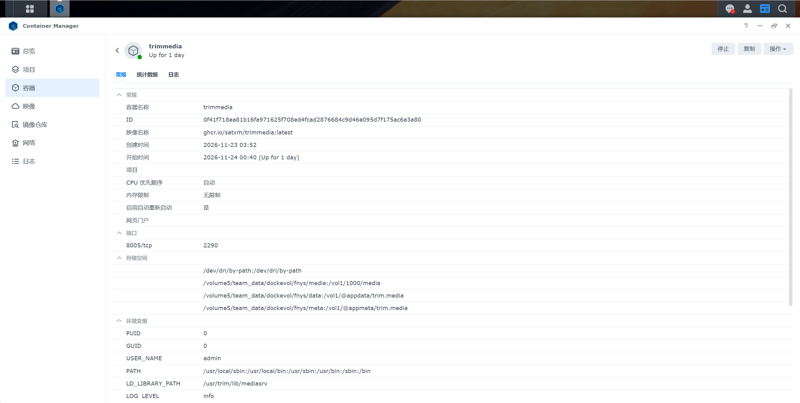

这张图里挂了三条，第三条 `@appmeta` 是多挂的，按上面表格可以省掉。出问题时对着这张图查三处：

- **端口** `8005/tcp` —— 容器内部端口，浏览器实际访问的是映射出来的 2290
- **存储空间** —— `media` 那条必须是你的媒体目录
- **环境变量** `PUID` / `GUID` —— 要和 `media` 目录的属主一致，不一致就写不进海报

### 1.3 检查是否起来了

```bash
docker ps | grep trimmedia
docker logs --tail 30 trimmedia
```

浏览器打开 `http://NAS的IP:2290`：


看到这个登录页就成功了。默认账号 **admin / 123456**，直接登。

> 想改密码：登录后左侧 **账号 → 修改密码**。
> 改过又忘了：见 [第 7 章 FAQ](#7-faq) 里的「密码忘了」，一条 sqlite 命令复位回 123456。

---

## 2. 部署 OpenList

镜像：`openlistteam/openlist`（AList 的社区延续版）

### 2.1 启动

```bash
mkdir -p /volume1/docker/openlist

docker run -d \
  --name openlist \
  --restart unless-stopped \
  --user 1001:1001 \
  -v /volume1/docker/openlist:/opt/openlist/data \
  -v /volume1/docker/trimmedia/media/strm:/strm \
  -p 15827:5244 \
  -e UMASK=022 \
  openlistteam/openlist:v4.2.10-aio
```

### 2.2 拿初始密码

```bash
docker logs openlist | grep -i password
```

日志里会打印类似 `password: xxxxxxxx` 的随机密码。

### 2.3 权限（关键，否则 strm 写不进去）

```bash
docker exec -it openlist id          # 确认容器内是 uid=1001
chown -R 1001:1001 /volume1/docker/trimmedia/media/strm
chmod -R 777       /volume1/docker/trimmedia/media/strm
```

> `--user 1001:1001` 里的 1001 要和 `docker exec -it openlist id` 看到的一致；
> 群晖上如果 1001 不存在，换成 `id -u` 的值，并同步改 chown。

浏览器打开 `http://NAS的IP:15827`，用 `admin` + 日志里的密码登录，进去后**个人资料 → 修改密码**。

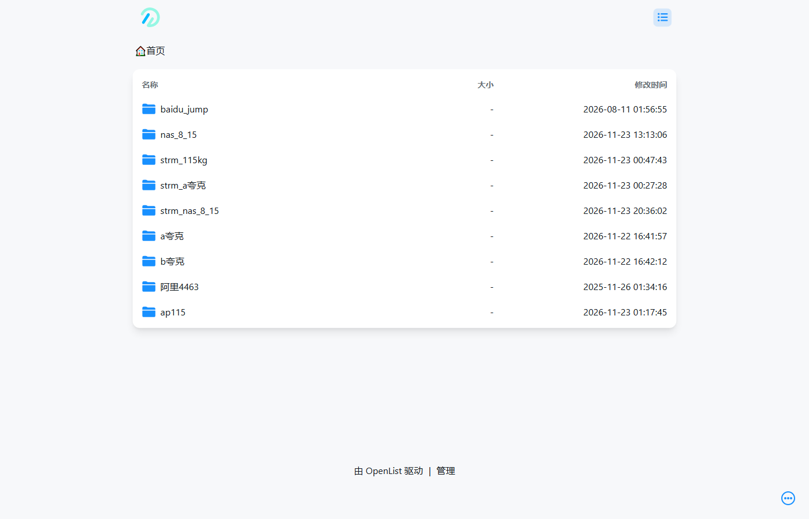

上图是登录后的首页，列表里的每个条目就是一个「存储挂载点」。看到这个页面说明 OpenList 起好了。

---

## 3. OpenList 挂网盘

进入 **管理 → 存储 → 添加**。

### 3.0 先做两个全局设置

**管理 → 设置 → 全局**：

| 选项 | 值 | 原因 |
|---|---|---|
| 签名所有 | **关闭** | 局域网内播放更省事（要公网访问就保持开启） |
| 写入操作后触发目录更新钩子 | 开启 | 网盘有新文件时自动刷新 |
| 目录更新钩子遍历限制速率 | 1 | 防止被网盘风控 |

### 3.1 挂 115 网盘

**管理 → 存储 → 添加**，驱动选 `115 网盘开放平台`，填三个框：

| 字段 | 填什么 |
|---|---|
| 挂载路径 | `/115` —— 网盘在 OpenList 里的名字，4.1 要引用它，别改 |
| 访问令牌 / 刷新令牌 | 两串字符，从哪来见下面 |
| 限制速率 | `1` —— 每秒最多 1 个请求，**必须填**，填 0 不限速很容易被 115 风控 |

**那两串令牌怎么来的**

115 用的是开放平台那套授权，不能直接填账号密码，得先换一对令牌：

1. 打开 <https://api.oplist.org>，选 115 网盘
2. 用你的 115 账号登录、同意授权
3. 页面会给出「访问令牌」和「刷新令牌」两段字符串，复制，粘进上面两个框

> 刷新令牌会过期，过期后 OpenList 里这个存储的状态会变成「异常」、目录打不开。这时候回授权页重新拿一对新的填进去就行，**不用删了重建**，媒体库也不受影响。

保存后回首页，看到 `/115` 目录、点进去能看到你的片子 = 成功。

### 3.2 挂夸克网盘

| 字段 | 填写 |
|---|---|
| 驱动 | `夸克网盘 TV`（或 `Quark`，用 Cookie） |
| 挂载路径 | `/quark` |
| 限制速率 | `1` |

选 `夸克网盘 TV` 时保存后会显示二维码，用手机夸克 App 扫码 → 扫完如果页面还显示二维码，
点一次 **禁用** 再 **启用**，状态变成「工作中」即可。

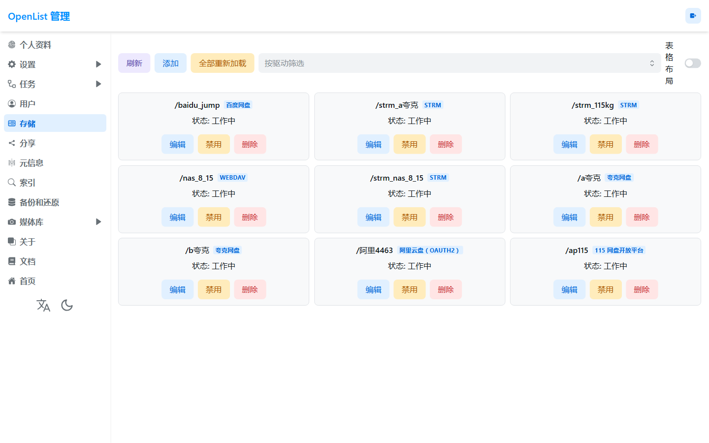

上图是挂完之后的存储列表：网盘驱动（`115 网盘开放平台`、`夸克网盘`）+ `STRM` 驱动都会出现在这里，状态都是「工作中」才算挂好。

### 3.3（可选）挂 WebDAV 源

手上有支持 WebDAV 的存储，就不用等 OpenList 出对应的专有驱动——通用的 `WebDAV` 驱动能把它接进来，对飞牛来说跟 115 没区别。

**管理 → 存储 → 添加**，驱动选 `WebDAV`：

| 字段 | 填什么 |
|---|---|
| 挂载路径 | 起个名，比如 `/webdav`、`/synology`，4.1 要引用它 |
| 地址 | 对方的 WebDAV 地址，**要带 `http://` 或 `https://`** |
| 用户名 / 密码 | 对方服务的账号 |
| 根文件夹路径 | 一般留空；想只挂某个子目录时填 |

常见的几家：

| 来源 | 地址大概长这样 | 备注 |
|---|---|---|
| 群晖（WebDAV Server 套件） | `http://群晖IP:5005` | 先在套件中心装并启用，端口按套件里显示的填 |
| 威联通 | `http://NAS_IP:5005` | 先在 App Center 开 WebDAV，端口以实际为准 |
| 坚果云 | `https://dav.jianguoyun.com/dav` | 密码要用它给的「应用密码」，不是登录密码 |
| 另一个 AList / OpenList | `http://那台机器:5244/dav` | 就是给别人共享片库的路子 |
| rclone（`serve webdav`） | `http://那台机器:端口` | rclone 能挂的网盘，这样一转就都能进飞牛 |

挂好之后回首页能看到这个目录、点进去能列文件，就跟 115 一样处理：到 [4.1](#41-添加-strm-存储115) 再建一个 Strm 存储，把「路径」填成这个挂载点。

> WebDAV 比 115 那种原生 API 慢，扫大目录会久一点，「限制速率」同样填 `1`。
> 群晖那条尤其适合「本地硬盘上的片子也想进同一个飞牛影视」的情况——不用搬文件，也不用再建一个库。

---

## 4. 生成 strm

OpenList 生成 strm 的方式是**再加一个 Strm 驱动的存储**（不是插件），它去扫描网盘目录、把每个视频写成一个 `.strm` 文件。

### 4.1 添加 Strm 存储（115）

**管理 → 存储 → 添加**：

| 字段 | 填写 | 说明 |
|---|---|---|
| 驱动 | `Strm` | |
| 挂载路径 | `/strm115` | OpenList 里给这个 strm 视图起的名字，随便起 |
| 路径 | `/115` | **上一步网盘的挂载路径**，不是 NAS 路径 |
| 站点 URL | `http://NAS的IP:15827` | 走内网填这个；要走公网就填你反代后的域名（见 4.6）。**不能填 localhost / 127.0.0.1**，否则直链是容器内地址，播不了 |
| 编码路径 | 开启 | 中文、空格、括号多的路径建议开 |
| 携带签名 | 关闭（配合 3.0 关闭签名所有） | 要公网访问就两边都开 |
| 保存 Strm 到本地 | **开启** | 关键，不开启 strm 只存在 OpenList 里，NAS 上看不到文件 |
| 本地保存 Strm 文件路径 | `/strm/115` | 容器内路径，对应宿主 `.../media/strm/115` |
| 本地保存模式 | `同步` | 网盘删了文件，本地 strm 也删 |

保存后回到首页，进入 `/strm115`，应该能看到网盘里的目录结构（此时还是空的，等扫描）。

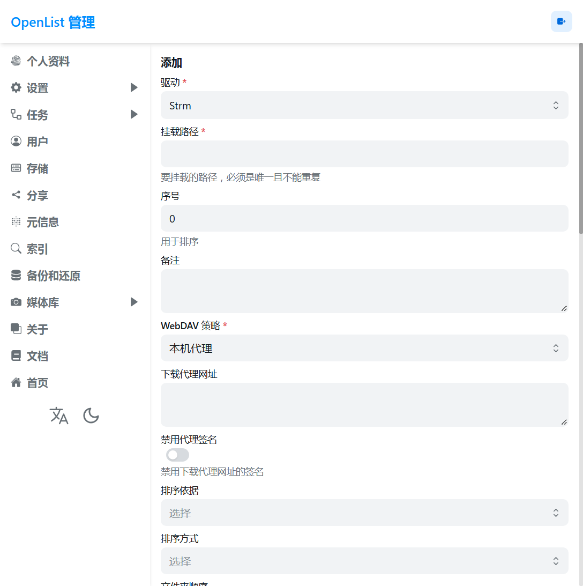

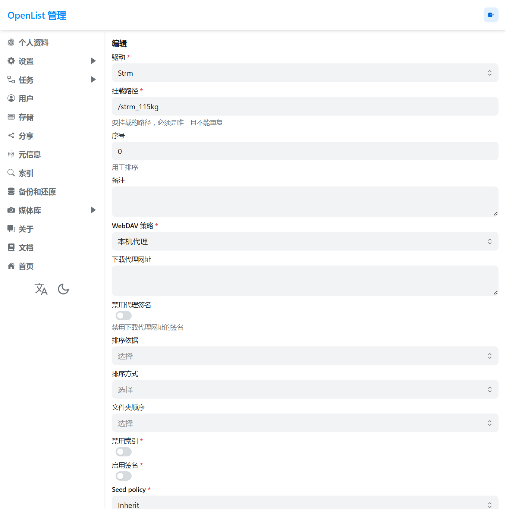

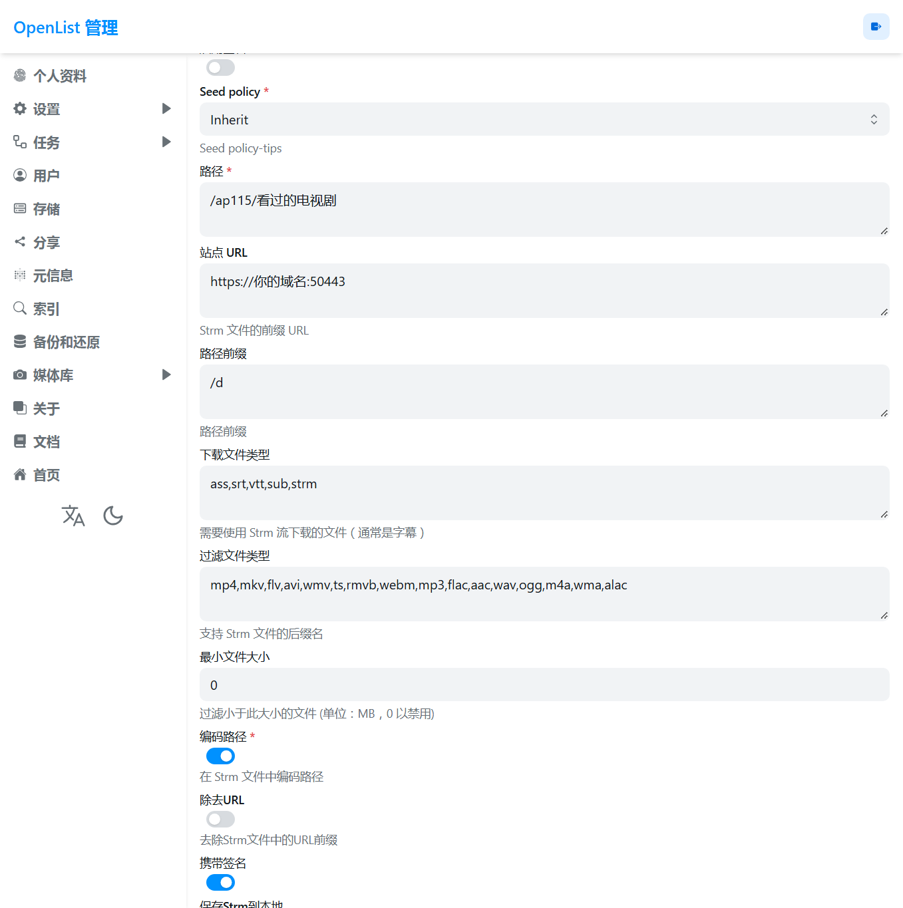

这张是最关键的：**「路径」= 网盘挂载点**（`/ap115/看过的电视剧`，不是 NAS 路径），**「站点 URL」= 你要填自己的地址**（内网填 `http://NAS的IP:15827`，公网填反代域名；原图域名已打码）。

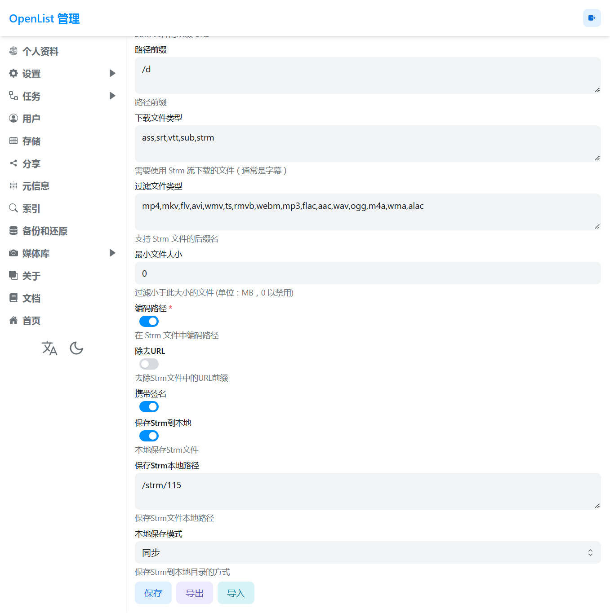

**「保存 Strm 到本地」必须打开**，否则 strm 只活在 OpenList 里，NAS 上永远是空目录。本地路径填容器内 `/strm/115`。

### 4.2 全量生成 strm（第一次必做）

**管理 → 索引 → 手动扫描**：

- 扫描路径：`/`（或只填 `/115`，只处理这一个网盘）
- 限制速率：`1`（每秒 1 个请求，防止被网盘风控；填 0 是不限速，容易被封）
- 点「开始」，等任务状态跑到完成

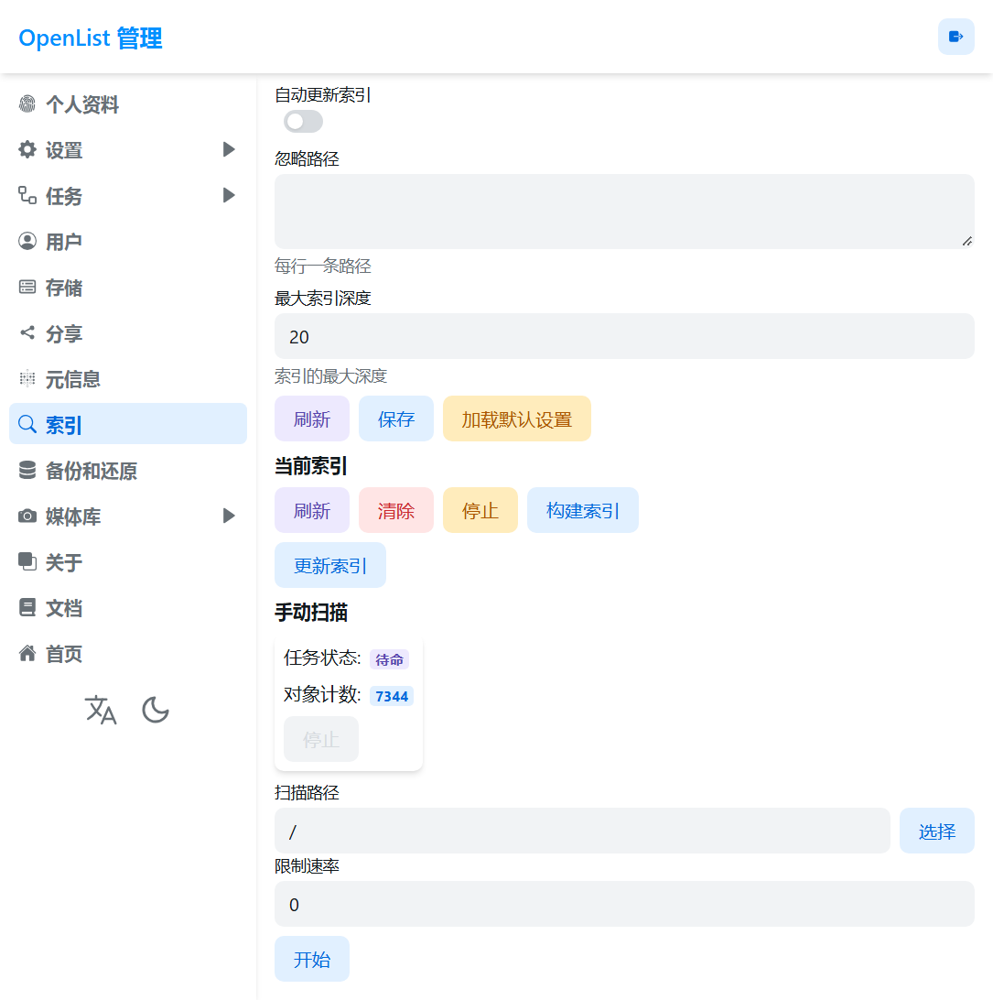

扫描会遍历目录，Strm 驱动随之把每个视频写成 `.strm` 落到本地。跑完后检查 NAS 上是否真的有文件：

```bash
ls /volume1/docker/trimmedia/media/strm/115 | head
```

看到 `.strm` 文件就对了。随便 `cat` 一个看看内容：

```bash
cat "/volume1/docker/trimmedia/media/strm/115/某剧/某剧 S01E01.strm"
# 输出类似： http://192.168.1.10:15827/d/115/某剧/某剧%20S01E01.mkv
```

> 这条 URL 用浏览器直接打开如果能下载/播放，说明网盘直链通了。

### 4.3 生成出来长什么样

目录结构就是「网盘里怎么分层，这里就怎么分层」：

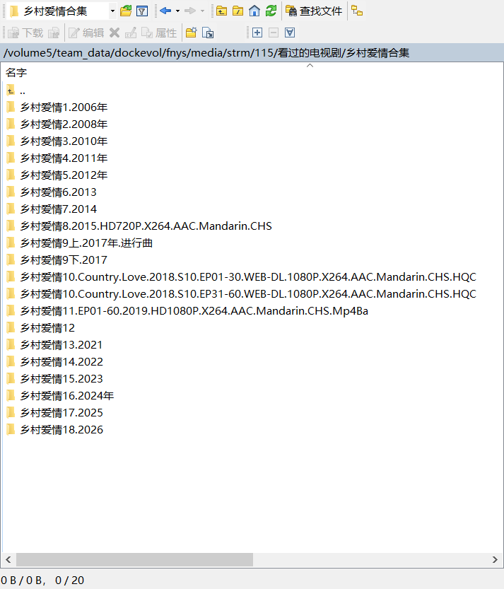

这是 `media/strm/115/看过的电视剧/乡村爱情合集`，19 个文件夹基本是一季一个（`乡村爱情9上` / `乡村爱情9下` 这种就是被拆成了两部），名字完全照抄网盘，**没有整理过**——所以才会出现「乡村爱情10.Country.Love.2018.S10.EP01-30.WEB-DL.1080P...」这种一长串。飞牛影视刮削靠的就是这些名字，别手动改。

点进其中一季：

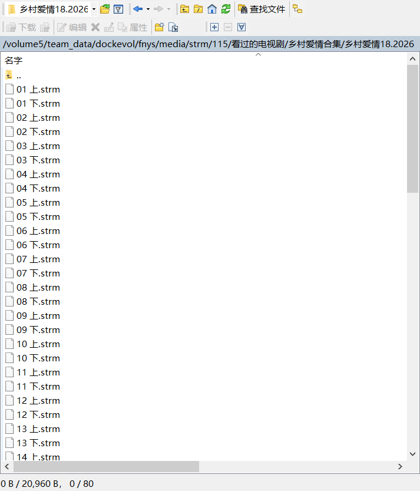

全是 `.strm`，**每个都是 0 KB 左右的纯文本**。看状态栏：40 个文件加起来才 20 KB——一集 4K 剧的「快捷方式」就一两百字节，NAS 上真正占地方的只有海报。

> 这份清单里有个坑：`01 上.strm` / `01 下.strm`，一集被拆成两个文件。飞牛和插件都会把它们当成「第 1 集」，两个文件抢一个集号。处理方式见 [6.5](#65-用修复集号) 末尾。

### 4.4 以后新增剧集怎么刷新

OpenList **没有**定时 Cron 索引（别去找）。它提供三种方式：

| 方式 | 操作 | 适用 |
|---|---|---|
| 进目录刷一下 | 在 OpenList 首页点进有新片的那一级目录 | 少量新增，最快 |
| 更新索引 | 管理 → 索引 →「更新索引」，填路径 | 已知某个目录有更新 |
| 手动扫描 | 同 4.2，路径填那个网盘 | 大批量新增 |

另有一个开关：**管理 → 索引 →「自动更新索引」**。打开后，你只要点进有变动的目录，它就会自动把该目录的索引重建一遍，不用手动点「更新索引」。

> 别去手写定时任务：OpenList 的接口需要带登录 token，用 curl 定时调很麻烦、也容易失效。
> 日常新增几部剧，点一下目录就够了；一次加几十部，就再跑一遍 4.2 的手动扫描。

### 4.5 夸克重复一次

同样的步骤，把「路径」换成 `/quark`、「本地保存路径」换成 `/strm/quark`、挂载路径换成 `/strmquark`。

挂了 WebDAV 源的话也再来一遍，本地路径换成 `/strm/webdav`。

### 4.6（可选）公网访问：Caddy 反代

只想在局域网看，跳过这节。想在电视、手机 4G 下也能播，就必须让**飞牛网页**和 **strm 里的直链**挂在同一个域名下——否则 strm 里写的是 `http://192.168.1.10:15827/d/...`，出门就播不了。

思路一句话：**同一个域名进来，根路径转给飞牛（2290），`/d/*` 转给 OpenList（15827）**。这样 strm 里的直链天然同源，不用改 OpenList，也不会撞 CORS。

Caddyfile（域名、邮箱、Cloudflare token、NAS IP 都换成自己的）：

```caddyfile
https://你的域名:50443 {
    # 除 /d/* 以外全部给飞牛影视
    reverse_proxy http://192.168.1.10:2290 {
        header_up X-Real-IP {remote_host}
    }

    # strm 直链走 OpenList
    reverse_proxy /d/* 192.168.1.10:15827

    tls 你的邮箱@example.com {
        dns cloudflare 你的CloudflareToken
    }
}
```

要点：

- **`/d/*` 这条必须在**，OpenList 的直链前缀就是 `/d/`（对应 4.1 里的「路径前缀」）
- 如果同时部署了 trimmedia-ext（第 8 章），再加一条 `handle_path /fntv-ext/* { reverse_proxy 127.0.0.1:2291 }`，插件的域名模式寻址靠的就是这个约定路径
- `reverse_proxy /d/*` 写在主 `reverse_proxy` 之后也没问题，Caddy 按最长匹配优先，但**主机名要写全**（`192.168.1.10:15827`，带端口）
- 用 `tls ... { dns cloudflare }` 是为了 **DNS-01 验证**：不用把 80/443 暴露到公网，非标端口（50443）也能签证书
- 这个 `dns cloudflare` 需要**带 DNS 插件的 Caddy**（官方镜像不含）：用 `caddy build --with github.com/caddy-dns/cloudflare`，或直接用 `ghcr.io/caddybuilds/caddy-cloudflare`
- 别用 443 端口直接占，家里路由多半 443 被封；50443 这种高位端口更省事
- 想记日志再加 `log` 指令 / 自己定义的 snippet；**没有对应 snippet 就把 `import LOG ...` 删掉**，否则 Caddy 加载会报错
- 反代好之后，回 **4.1 把「站点 URL」改成 `https://你的域名:50443`**，重新跑一次 4.2 的手动扫描，strm 里的链接才会换成新域名
- 如果 3.0 里「签名所有」开着，strm 直链会带签名参数，Caddy 这边不用管；但改域名/端口后旧签名会失效，同样要重新扫描

> 反向代理的另一个好处：115 / 夸克 的真实地址不会暴露给客户端，网盘那边看到的永远是「OpenList 在请求」。

---

## 5. 飞牛影视建媒体库

1. 浏览器打开 `http://NAS的IP:2290`，登录
2. 左侧 **媒体库 → 新建媒体库**

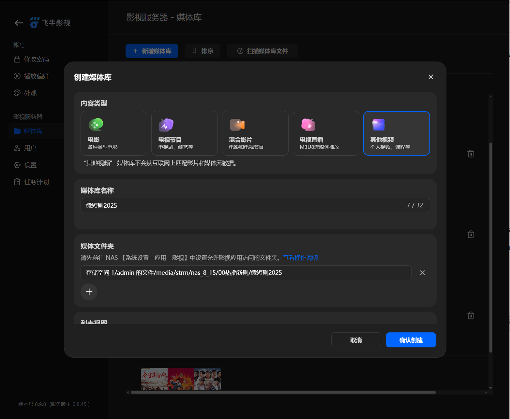

上图几个点对着看：

- **内容类型**：图上选的是「其他视频」，因为那是短剧合集，不需要联网刮削（选了它，飞牛不会去 TMDB 找元数据，直接按文件名建条目）。正经电视剧选**电视节目**，电影选**电影**。
- **媒体库名称**：随便起，只是显示用。
- **媒体文件夹**：**最关键的一行**，要选**容器内路径**，不是 NAS 宿主路径。

   | 你想要的 | 就选这个容器内路径 |
   |---|---|
   | 115 的剧 | `/vol1/1000/media/strm/115` |
   | 夸克的剧 | `/vol1/1000/media/strm/quark` |

   > 图上选到的是 `.../media/strm/nas_8_15/00热播新剧/微短剧2025`——这是**故意选到子目录**的用法：同一个 strm 盘里，把某部短剧单独拉出来建一个库。你可以按季/按类型随便切分，一个库指向任意一层子目录都行。
   >
   > 115 和夸克分别建两个库更好管理；想省事就建一个指向 `/vol1/1000/media/strm`。

点「确认创建」后自动开始扫描，几十集大概 1–3 分钟。

> 图上那句「请先前往 NAS【系统设置 - 应用 - 影视】中设置允许影视应用访问的文件夹」是飞牛原生系统的路径授权提示。**Docker 部署直接忽略**——你已经用 `-v` 把 `media` 映射进容器了，容器能看到的就是这些目录。

扫描完回到首页，海报墙就出来了。点进剧集能看季/集列表。

### 5.1 多个库怎么分（可选）

一个库 = 一个目录，想建几个建几个。真实的分法大概是这样：

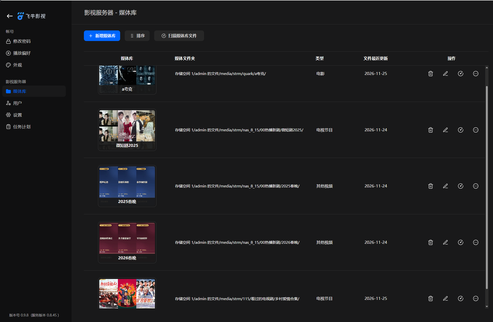

| 库名 | 类型 | 指向的容器内路径 |
|---|---|---|
| `a夸克` | 电影 | `/vol1/1000/media/strm/quark/a夸克` |
| `乡村爱情合集` | 电视节目 | `/vol1/1000/media/strm/115/看过的电视剧/乡村爱情合集` |
| `微短剧2025` | 电视节目 | `/vol1/1000/media/strm/.../00热播新剧/微短剧2025` |
| `2025春晚` / `2026春晚` | 其他视频 | 各自年份的目录 |

三条经验：

- **电影和电视剧分库**。混一个库里，海报墙会乱，选集面板也用不上。
- **短剧、春晚、课程、个人录像用「其他视频」**。这些没有 TMDB 条目，硬用「电视节目」只会刮出一堆错海报，还把扫描拖得很慢。
- **库名带上来源**（`a夸克`、`115` 这种）。以后某一集播不了，看库名就知道该去哪个网盘找原因。

> 刮削默认走 TMDB，国内网络可能很慢或失败。想用豆瓣 → 下一步。

---

## 6. 装浏览器插件（豆瓣匹配 + 修复集号）

这一章不碰 NAS，全在你的电脑浏览器里做。

### 6.1 先装插件宿主：篡改猴

「篡改猴」（Tampermonkey）本身不是我们要的功能，它是**一个给网页装小插件的浏览器扩展**——装好它，飞牛影视的网页上才能多出那两个按钮。

在你平时看片的那个浏览器里装：

- Chrome / Edge：扩展商店搜 `Tampermonkey`
- Firefox：附加组件商店搜 `Tampermonkey`
- 商店打不开：<https://www.crx4chrome.com/crx/3441/> 下载离线包，开发者模式加载

### 6.2 装插件本体

插件就是本仓库根目录那个 **`fntv-douban-helper.user.js`**，一个文件，没有别的依赖。

**方式一：一键安装**（推荐）

打开这个地址，篡改猴会自动弹出安装页：

```
https://raw.githubusercontent.com/jamosnet/fntv-douban-kit/main/fntv-douban-helper.user.js
```

点「安装」即可。

**方式二：手动装**

下载本仓库的 `fntv-douban-helper.user.js` → 点篡改猴图标 → 添加新脚本 → 全删 → 把内容粘进去 → `Ctrl+S`。

> raw 地址国内偶尔打不开，换镜像：
> `https://cdn.jsdelivr.net/gh/jamosnet/fntv-douban-kit@main/fntv-douban-helper.user.js`

> 之前装过内测版的注意：那时文件叫 `trim_douban_helper.user.js`、版本是 1.3.x，现在仓库里已经没有这个文件了。先去篡改猴管理面板把旧的那条**删掉**再装——命名空间变了，篡改猴会当成两个脚本，页面上会冒出两个面板。

装完点篡改猴图标，列表里能看到「飞牛影视 豆瓣匹配助手」这一条，状态是**已启用**就成。

### 6.3 确认面板出现

访问 `http://NAS的IP:2290/v/`，登录后**页面右下角**出现深色面板「豆瓣匹配助手」，点标题栏展开。


看不到面板：确认地址是 `/v/` 开头、按 F5 刷新、等 2 秒。

### 6.4 用豆瓣匹配

**第一步：拿到豆瓣链接**（大部分人卡在这）

1. 浏览器打开 <https://movie.douban.com>，在搜索框打片名
2. 在结果里找**对应那一季**的条目。豆瓣的剧是**按季分开的**——搜「权力的游戏」会出来第一季、第七季、第八季…点错季，海报和集数就跟你的文件对不上
3. 在标题链接上**右键 → 复制链接地址**（Chrome 左下角会先显示这个地址，可以核对一下对不对）


复制出来是 `https://movie.douban.com/subject/26584183/` 这种形式，`subject/` 后面那串数字就是条目的身份证。

**第二步：回到飞牛影视的页面**

1. 点开要处理的影视条目（地址栏要是 `/v/` 开头）
2. 面板里粘贴刚复制的豆瓣链接
3. 类型选「电视剧」（电影就选「电影」）
4. **预览豆瓣** → 确认片名年份对得上，再看一眼集数
5. **开始豆瓣匹配** → 最多等 45 秒

> 预览那一步别跳过：豆瓣同名同姓的条目不少（尤其「XX 第一季」和「XX 合集」），预览里片名+年份+集数三项都对上，再提交。

普通库会重建条目（收藏/播放记录可能丢）；本地 NFO 库会忽略在线匹配，插件会自动改为直接写入海报/简介/年份/评分/演职员（只填空缺）。

### 6.5 用修复集号

文件名没有集号标记时，整部剧会挤在「特别篇」、显示 0 季 1 集。修复：

1. 打开该剧的季页面（或剧集详情页）
2. 面板里 **季号填 `1`**（`0` 是特别篇，别填错）
3. 点 **修复集号（批量）**
4. 弹出预览框，**先核对数字**：

   ```
   将把 41 个文件编入【第 1 季】
   集号范围：1 – 41
   编号方式：按文件名解析出的数字
   示例：
     乡村爱情S16 01 4K.strm  →  第 1 集
     乡村爱情S16 02 4K.strm  →  第 2 集
   确认提交？
   ```

5. 数字对得上点「确定」，等 20–40 秒，刷新页面


上图是修完的效果：选集「1 – 30 / 31 – 41」，共 41 集，不再有「特别篇」。

**文件名怎么被识别**（按顺序匹配，命中即用）：

1. `S01E05` / `S01.E05` / `S01EP05`
2. `第5集` / `第5话` / `第5期` / `第5回`
3. `EP05` / `E05`
4. 文件名里**最后一个独立数字**（会跳过 1080 / 2160 / 4K / 年份 / `S16` 这类标记）

所以 `乡村爱情S16 01 4K.strm` → 第 1 集（`S16` 是剧名，不是季号）。

**如果文件名里的数字靠不住**（比如全部解析成同一集），勾选面板里的
「按文件名顺序编号（忽略文件名里的数字）」，改为按文件排序依次编 1、2、3…

**特殊情况：一集被拆成「上/下」两个文件**（就是 [4.3](#43-生成出来长什么样) 第二张图里那种 `01 上.strm` / `01 下.strm`）。

两个文件解析出来都是「第 1 集」，撞号。插件会弹一个确认框提醒你「有文件集号重复」，它不会自己瞎猜，得你决定：

| 你想要的 | 怎么做 | 代价 |
|---|---|---|
| 保持真实集数（41 集） | 删掉其中一个（比如只留 `上`） | 每集只能看前半段 |
| 能完整播放 | 勾「按文件名顺序编号」，让它编成 1–82 | 集号翻倍，跟豆瓣/网上的集数对不上 |

最干净的其实是**回网盘找没拆过的完整版**——这种「上下集」的片源是上传者自己切的，任何按文件名识别的工具都没法还原。

### 6.6 特别篇检查（发现 + 逐条手动修正）

批量修复适用于「整部剧挤在特别篇」的规整场景。不知道**哪些剧**有问题、或者只想挑几集修，用 **特别篇检查**：

1. 任意页面打开面板（在媒体库页 / 剧集详情页 / 季页都行），「豆瓣匹配」tab → 点 **特别篇检查（扫全库，找出带特别篇的剧）**
2. 插件**扫全库所有剧集**（不管你在哪个页面，每次都是全量扫描），列出**哪些剧带 季=0、集=0 的错挂集**及条数（按剧折叠分组，默认收起）
3. 点开剧名展开明细：文件名 + **季/集输入框**（集号已按文件名预填），逐条核对改掉不对的
4. 勾选要修的行（默认全勾，解析不出集号的行集号是空的、填上才会提交），点 **提交修正（该剧勾选集）**——按剧逐部提交，互不影响

提交走官方 `rescrap/batch` 通道（与 6.5 相同），服务端自动重建季节结构，约 20–40 秒后刷新页面。全库扫描实测 100+ 部剧约 15–20 秒，面板按钮上有进度提示。

---

## 7. FAQ

**Q：群晖 Container Manager 里 `--device /dev/dri` 报错**
机器没有可用核显，或 DSM 没加载 `i915` 驱动。删掉 `--device /dev/dri:/dev/dri` 和 `/dev/dri/by-path` 两行，改软解，能播但 4K 会卡。

**Q：2290 端口打不开**
`docker ps` 看容器是否 Up；`docker logs trimmedia` 看有没有启动报错；NAS 防火墙是否拦了端口。

**Q：OpenList 里能看网盘，但 NAS 上没有 .strm 文件**
三个原因，按顺序查：
1. Strm 存储没开「保存 Strm 到本地」→ 重新编辑打开
2. 没跑索引 → 管理 → 索引 → 手动扫描
3. 权限 → `docker exec -it openlist id` 和 `chown` 的 uid 对不上

**Q：strm 生成了，飞牛也能刮削，但播放失败（404 / 403 / 一直在转圈）**
1. `.strm` 里的 URL 是 `127.0.0.1` 或 `localhost` → 站点 URL 要填 NAS 的局域网 IP，改完重新索引
2. 签名不一致 → 全局「签名所有」和 Strm 的「携带签名」要么都开要么都关
3. 中文路径播放失败 → 把 Strm 的「编码路径」关掉再试（或反过来开）
4. 网盘限速/风控 → 播放时限制速率 1，别并发多集

**Q：飞牛影视扫不到文件 / 扫到了但海报是空白**
- 媒体文件夹选错成宿主路径 → 必须选容器内 `/vol1/1000/media/...`
- 容器 PUID/GUID 和 media 目录属主不一致 → `chown -R 1000:1000 media`
- 刮削失败 → 多半是 TMDB 网络问题，用第 6 步的豆瓣插件

**Q：重新生成 strm / 刷新索引，会把豆瓣匹配和集号纠正弄丢吗**

**不会**，只要网盘上的目录和文件名没变。

三件事保证了这一点：

| 事实 | 为什么安全 |
|---|---|
| 刮削结果存在数据库，不在 strm 里 | 你的 strm 目录里 80 个文件总共才 20 KB，清一色 `.strm`，没有 nfo / 海报。豆瓣匹配、集号都写在 `/vol1/@appdata/trim.media/database/trimmedia.db`，改 strm 碰不到它 |
| 内容没变就根本不写 | OpenList 重新生成时会先算 SHA256 比对，**内容一模一样直接跳过**，连修改时间都不动，飞牛完全感知不到 |
| 内容变了也是原地覆盖 | 换了签名或域名时，OpenList 用截断重写（不是删除重建），路径、文件名都没变，飞牛按路径匹配到的还是同一个条目 |
| 「同步」模式只删网盘已删的 | 本地保存模式选「同步」时，只会清理云端已经不存在的文件，不会无差别重建 |

**会真的失效的只有三种操作**（都跟"路径变了"有关）：

1. 在网盘上给文件夹改名 / 移动位置 → 路径变了，飞牛认为旧文件消失，旧条目连同豆瓣匹配一起没
2. 手动把 `media/strm/115` 整个删掉再全量生成 → 所有文件瞬间消失
3. 删掉 OpenList 的 115 存储重建时，本地路径填成了另一个目录

另外，**网盘上增删了集会怎样**：已有集的集号不动，新多出来的文件会掉进「特别篇」，再跑一次 6.5 的修复就行。

保险起见，重新生成前备份一次数据库，出事直接拷回来：

```bash
docker exec trimmedia sh -c 'cp /vol1/@appdata/trim.media/database/trimmedia.db /vol1/@appdata/trim.media/database/trimmedia.db.bak'
```

想实测验证也很简单：打开剧集页面，看地址栏 `/v/剧名/` 后面那串 **32 位十六进制**，重新生成前后对比——**ID 一样就是同一个条目，豆瓣匹配和集号都还在**。

**Q：密码忘了 / 想重置 admin 密码**

默认账号密码就是 `admin` / `123456`，从来没改过的话直接用它登。

真忘了，两条路，按你的情况选：

**办法一：直接重建容器**（没挂 `data` 目录时最省事）

没挂 `data`（[1.2](#12-启动容器) 里的可选卷），数据库就不在 NAS 上：`docker rm -f trimmedia` 删掉，再按 1.2 的 `docker run` 跑一遍，密码自动回到 `123456`。唯一代价是媒体库要重扫一次。

**办法二：改数据库**（挂了 `data`，不想重扫时用）

```bash
# 1. 先备份，防手抖
docker exec trimmedia sh -c 'cp /vol1/@appdata/trim.media/database/trimmedia.db /vol1/@appdata/trim.media/database/trimmedia.db.bak'

# 2. 把 admin 的密码 hash 换回 123456（下面这串就是 123456 的 hash）
docker exec trimmedia sh -c "sqlite3 /vol1/@appdata/trim.media/database/trimmedia.db \"UPDATE user SET passwd='dJp5/s0mfAaCA1d1p3YTxQBVDJJmQzJb3K/dNghHRLM=' WHERE username='admin';\""

# 3. 重启
docker restart trimmedia
```

登进去之后再改成自己的密码：左侧 **账号 → 修改密码**。挂了 `data` 目录的话，改完的密码会一直保留到下次重建容器。

**Q：能放 115 和夸克以外的网盘吗**
能。OpenList 的存储驱动有几十种（阿里云盘、天翼、OneDrive、PikPak、百度、迅雷…），挂上之后跟 115 一模一样：加一个 Strm 存储、跑一次索引，飞牛就能刮。
对方只提供 WebDAV 地址的，用通用的 `WebDAV` 驱动接进来也一样，见 [3.3](#33可选挂-webdav-源)。

**Q：strm 里的直链泄露了 / 想让旧链接全部作废**

先说清楚这东西有多敏感：strm 里那条 `http://NAS:15827/d/115/...` 是**免登录直链**——谁拿到它、又能连到你 NAS 的网络，不用账号密码就能直接播。所以别把 strm 内容贴群里、别截图外发。

真泄露了，按顺序做，别只做一半：

**① 看你的直链有没有 `?sign=`**

```bash
cat "/volume1/docker/trimmedia/media/strm/115/某剧/某集.strm"
```

- 尾巴上带 `?sign=xxxxxxxx` → 有签名，进第 ② 步
- 光秃秃一条 URL → 没签名（3.0 里「签名所有」关了），先跳到第 ③ 步把签名打开

**② 换掉签名密钥，旧链接立刻全部失效**

OpenList → **管理 → 设置 → 全局 → 「令牌（Token）」**，改成一串新的随机字符，保存。

签名是用这串令牌算出来的，一改，之前发出去的所有 `?sign=` 全部作废——别人再点就是打不开，你这边也不用手动删什么。

> 注意：**换完必须重新生成 strm**，因为你自己文件里存的也是旧签名。
> 回 [4.2](#42-全量生成-strm第一次必做) 跑一次手动扫描（或「更新索引」扫那个网盘目录），跑完 strm 里就是新签名了。
>
> 网上流传的「一键改签名」脚本，干的也就是这一件事——改令牌 + 重扫。不用额外装东西。

**③ 没有签名的直链，先把签名打开**

3.0 的「签名所有」+ 4.1 的「携带签名」两个开关都打开，然后重扫一遍。之后每条直链都带 `?sign=`，再出问题就能用第 ② 步一键作废。

**④ 如果泄露的不只是直链**（比如 OpenList 的账号密码、115 的令牌也被人看到了）

- OpenList 侧：**管理 → 用户 → 改密码**
- 115 侧：去 115 官方把授权/登录设备清一遍，重新走一次 [3.1](#31-挂-115-网盘) 的授权，旧令牌随之失效

> 额外提醒：如果只是想**换域名/换端口**（不是泄露），不用重扫，直接批量改 strm 里的地址更快：
>
> ```bash
> cd /volume1/docker/trimmedia/media/strm
> grep -rl "http://192.168.1.10:15827" . | while read -r f; do
>   sed -i "s|http://192.168.1.10:15827|https://你的域名:50443|g" "$f"
> done
> ```
>
> 这条只替换地址、不动签名，所以只适用于**没开签名**的情况。开了签名就只能重扫，让 OpenList 重新签。

**Q：这套方案会被网盘判定违规吗**
播放走的是你自己的会员账号直链，不重新上传、不转存。但**限制速率 1** 很重要，大量并发请求容易被风控。

---

## 8. trimmedia-ext：标题排序修复（官方 bug 的自救方案）

**先说结论**：飞牛影视按「标题」排序读的是隐藏列 `sort_title`，数字不补零就会排成 1,10,11,2,3 这种字典序（`乡村爱情` 系列实测：18 排第一）。这是官方已知 bug（论坛 tid=68921、tid=54046，2026 年 2 月反馈至今未修），官方接口**没有任何写入口**能改这个字段，改片名也不更新。

本 kit 的解法：一个**旁路小容器**直接操作 trimmedia 的 sqlite 数据库。不注入官方容器、不动官方镜像，删掉几行 compose 配置就完全还原。

### 8.1 它能做什么

| 模块 | 能力 | 说明 |
|---|---|---|
| `patch` | 条目字段修正 | 白名单字段（标题/sort_title/发行时间/季数/集数/评分等）预览后写库——修复错误刮削、补豆瓣评分、修正排序 |
| `item` | 条目读取（只读） | 按 guid 返回标题/发行时间等可编辑字段，供插件「手动改值」表单预填 |
| `orphans` | 孤儿条目清理 | 删剧后残留的悬空单集检测与删除 |
| `health` | 库健康检查 | 只读统计：无封面/缺日期/孤儿/重复路径 |

**安全机制**：所有写操作都是「预览 → 确认 → 执行」两段式；每次写库前自动备份（保留最新 10 份，可一键恢复）；字段白名单写死，**没有任何任意 SQL 入口**；鉴权复用官方登录态——插件转发的 token 会回官方验证 `is_admin`，只有管理员能调。

### 8.2 启用（约 2 分钟）

镜像固定 `python:3.11-alpine3.20`（纯标准库零依赖，无 build 无 pip install）。

**方式一：docker run（推荐，一条命令，不用保存任何文件）**

```bash
# 1. 下载服务脚本到 NAS（就一个文件）
mkdir -p /volume1/docker/fntv-ext && cd /volume1/docker/fntv-ext
curl -L -o server.py https://raw.githubusercontent.com/jamosnet/fntv-douban-kit/main/ext/server.py

# 2. 起容器（改两处：数据目录路径、飞牛影视地址）
docker run -d --name trimmedia-ext --restart unless-stopped \
  -p 2291:80 \
  -e FNTV_DB=/data/database/trimmedia.db \
  -e FNTV_BACKUP_DIR=/data/ext-backups \
  -e FNTV_TRIM_URL=http://192.168.8.138:2290 \
  -v /volume1/docker/fntv-ext:/ext:ro \
  -v /volume1/docker/trimmedia/data:/data \
  python:3.11-alpine3.20 \
  python /ext/server.py
```

> 两个挂载：`/ext` 放刚下载的 server.py（只读）；`/data` 是 trimmedia 挂载出来的数据目录，里面要有 `database/trimmedia.db`。
> `FNTV_TRIM_URL` 填你的飞牛影视地址，用于管理员鉴权。

**方式二：compose**

`docker-compose.yml` 里找到 `trimmedia-ext` 注释块，去掉行首 `# `，改 `FNTV_TRIM_URL` 和数据目录两处，然后 `docker compose up -d trimmedia-ext`。

**验证**：浏览器开 `http://NAS的IP:2291/` 看到 JSON 服务信息即成功（端口约定 = 影视端口 + 1）。

**升级**：重新下载 server.py 覆盖旧文件，然后 `docker restart trimmedia-ext` 即可（数据库与备份不受影响）。

### 8.3 篡改猴插件里用

插件面板第二个 tab「**手动改值**」（通用排序修复）：

- 官方「标题」排序实际读的是隐藏字段 `sort_title`，「发行时间」排序读 `air_date/first_air_date`——这些值官方界面都不给改，本 tab 就是补这个缺口的
- 在**条目详情页**打开面板自动带出当前 **title / sort_title / 发行时间**，三个都是独立可编辑字段，改完点「保存修改」一键写库（每次写入前自动备份，可通过 `/api/backups/restore` 恢复）
- 用法示例：权力的游戏第二季 → 标题改 `权力的游戏 02`、sort_title 改 `权力的游戏 02`、发行时间填 `2012-04-01`，之后无论按标题还是按发行时间排序都自然正确
- 扩展服务地址输入框就在本 tab，**通常留空即可**（自动寻址）：**IP 访问**（含 localhost）按「当前页面端口 +1」（2290 → 2291）；**域名访问**（带不带端口都算，如 `https://你的域名:50443`）按「当前域名 + `/fntv-ext`」寻址。只有当反代路径不是 `/fntv-ext` 时才手动填实际地址：
  ```
  handle_path /fntv-ext/* {
      reverse_proxy 127.0.0.1:2291
  }
  ```
- 面板支持**标题栏拖动**移动位置、**右下角◢拖拽**调宽度，位置和宽度都会记住


**sort_title 的正确写法（实测结论，勿踩坑）**：官方按 `sort_title` 列做 SQLite 默认字节序排序，所以：

- ✅ 正确格式 = **相同前缀 + 补零两位数字**：`乡村爱情01`…`乡村爱情18`、`权力的游戏01`…`权力的游戏08`——字典序即自然序
- ❌ 中文数字是坑：`第一季`…`第八季` 按字节序排成一<七<三<二<五<六<四<八（Unicode 码点乱序）；纯拼音不补零同样 1,10,11,2 乱
- ❌ 标题与 sort_title 都改成中文并**不会**让排序正确，sort_title 里必须出现可比较的阿拉伯数字
- ⚠ **官方「编辑信息」保存时会自动重写 sort_title**（把标题拼音化/原文写入），所以用官方编辑改过标题后，sort_title 会被打回原形——改完标题记得回本面板把 sort_title 再写成补零格式
- 已通过官方接口实测：写入补零格式后刷新页面立即生效，无需重启（官方按需读库，无强制缓存）

> 更早的「排序修复」批量模块（`/api/sortfix`，「剧名+数字」正则补零）已在 ext 1.2.1 整体移除：场景有限，改用本 tab 逐条改 sort_title 即可。

### 8.4 手动验证（不用插件也行）

```bash
# 预览会改什么（只读；guid 换成实际条目）
curl -X POST "http://NAS的IP:2291/api/patch/preview" \
  -H "X-Ext-Token: 你的token" -H "Content-Type: application/json" \
  -d '{"items":[{"guid":"条目guid","fields":{"sort_title":"权力的游戏02"}}]'
```

命令行调试可给容器加环境变量 `-e FNTV_TOKEN=你的调试token`（run 命令里加一行即可），之后所有请求带 `-H "X-Ext-Token: ..."`。不设则只认官方管理员 token。

### 8.5 代码在哪

`ext/server.py` 一个文件，Python 3.11 纯标准库（`python:3.11-alpine3.20` 镜像，无 build 无 pip install），全部逻辑明文可审计。测试：`ext/test_local.py`（21 项断言，含官方鉴权联测）。

---

## 9. 备份与升级

**要备份的只有两样**（都不大）

```bash
# OpenList 的配置和网盘凭据（必须）
tar czf openlist-backup-$(date +%F).tar.gz /volume1/docker/openlist

# 飞牛影视的数据库（前提是你挂了 data 目录，见 1.2）
tar czf trimmedia-db-$(date +%F).tar.gz /volume1/docker/trimmedia/data
```

> `media` 不用备份：里面全是几百字节的 strm 文本 + 海报，扫一遍就能重新生成。
> 没挂 `data` 目录的话，第二行直接跳过——代价是重建容器后要重新刮削一遍。

**升级飞牛影视/OpenList**

```bash
docker pull ghcr.io/satxm/trimmedia:latest
docker rm -f trimmedia
# 重新执行第 1.2 节的 docker run（卷不变，数据不会丢）
```

---

## 文件说明

```
.
├── README.md                      本教程
├── SCREENSHOTS.md                 截图索引 + 打码规则
├── docker-compose.yml             飞牛影视 + OpenList 的 compose
├── scripts/deploy.sh              一键建目录 + 起两个容器
├── fntv-douban-helper.user.js     篡改猴插件（豆瓣匹配 / 修复集号 / 手动改 sort_title 与发行时间）
├── ext/                           trimmedia-ext 数据库扩展服务（见第 8 章）
│   ├── server.py                  服务本体：Python 3.11 纯标准库单文件
│   └── test_local.py              本地端到端测试（21 项断言）
└── screenshots/                   18 张截图
```

## 致谢 / 参考

- 飞牛影视独立化镜像：[satxm/trimmedia](https://github.com/satxm/trimmedia)
- OpenList：<https://github.com/OpenListTeam/OpenList> ｜ 文档 <https://doc.oplist.org>
- 115 开放平台令牌：<https://api.oplist.org>

## License

MIT（脚本与文档）。镜像本身版权归各自项目所有。
